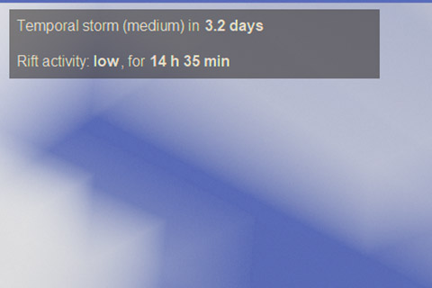
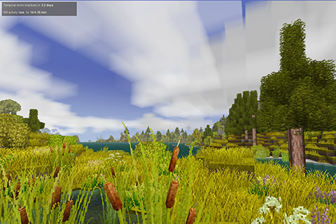
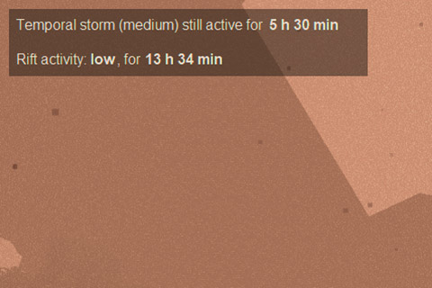
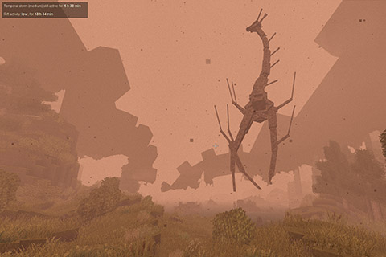

#  Temporal Storm HUD

A **Vintage Story 1.22.x** mod (tested on 1.22.7). Client-side only, so it also works on other people's servers.

Shows a persistent HUD on screen (top-left corner by default, see [Settings](#settings)):

```
Temporal storm (light) in 18.0 days

Rift activity: calm, for 9 h 40 min
```

- **Temporal storm**: strength and time until the next storm (one decimal place in days from one day up, game hours and minutes below that); during a storm, the time until it ends.
- **Rift activity**: the current level (name taken from the game's translation) and how many in-game hours it will last.

All times are in-game time.

## Screenshots

| | |
|---|---|
| **Before a storm** | |
|  |  |
| **During a storm** | |
|  |  |

## Languages

English (default) and Polish. The HUD follows the game's language setting; for other languages it falls back to English. Translations live in `assets/tempstormhud/lang/` – contributions are welcome.

## Installation

Download `tempstormhud_X.Y.Z.zip` from Releases and put it **without unpacking** into the `VintagestoryData/Mods` folder. Remove the previous version of the mod, if any.

## Controls

`Ctrl+Shift+T` – open/close the settings window (can be changed in the game's control settings).

## Settings

The settings window has:

- **Show HUD** – shows or hides the HUD.
- **Position** – top left, top center, top right, middle left, middle right, bottom left or bottom right.

While the settings window is open, you can also drag the HUD anywhere with the mouse; the position list then shows **Custom**. A dragged HUD keeps its distance from the nearest screen edge, so it stays in place when the window is resized. Choosing a position from the list moves it back to that edge.

Changes apply immediately and are saved in `VintagestoryData/ModConfig/tempstormhud.json`, so there is no need to edit the file by hand. If the file can't be read, the mod uses the default settings, logs a warning and leaves the file unchanged until a setting is changed in the window.

## Limitations

- After `/nexttempstorm now` the server does not send an update to clients, so the storm countdown shows the old value until the storm starts.
- The rift activity line appears only once the server sends its data (on joining the world).

## Building

Requirements: .NET 10 SDK and the `VINTAGE_STORY` environment variable pointing to the game's installation folder:

```powershell
[Environment]::SetEnvironmentVariable("VINTAGE_STORY", "$Env:AppData\Vintagestory", "User")
```

```powershell
dotnet build                  # compile check + zip in bin/release/
dotnet build -p:Deploy=true   # also replaces the mod in %AppData%\VintagestoryData\Mods
```

The mod is distributed as a zip containing the `.cs` source and assets – the game compiles it itself on startup. The `.csproj` project is used to check the code against the game's libraries and to package the zip.

## License

MIT – see [LICENSE](LICENSE).
